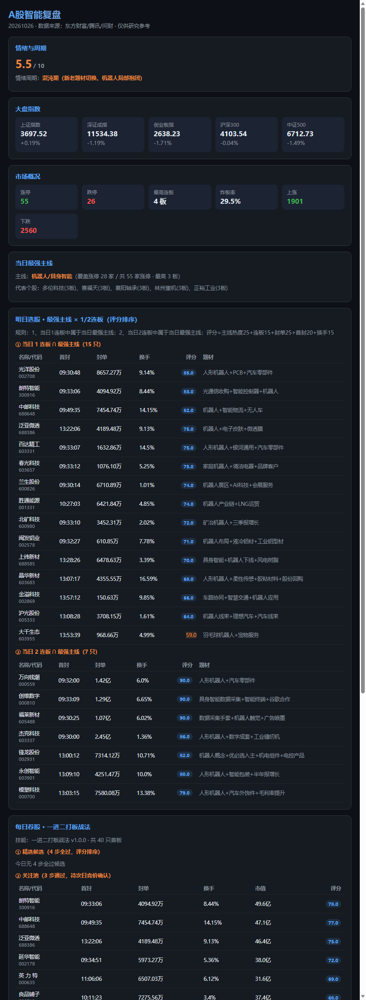
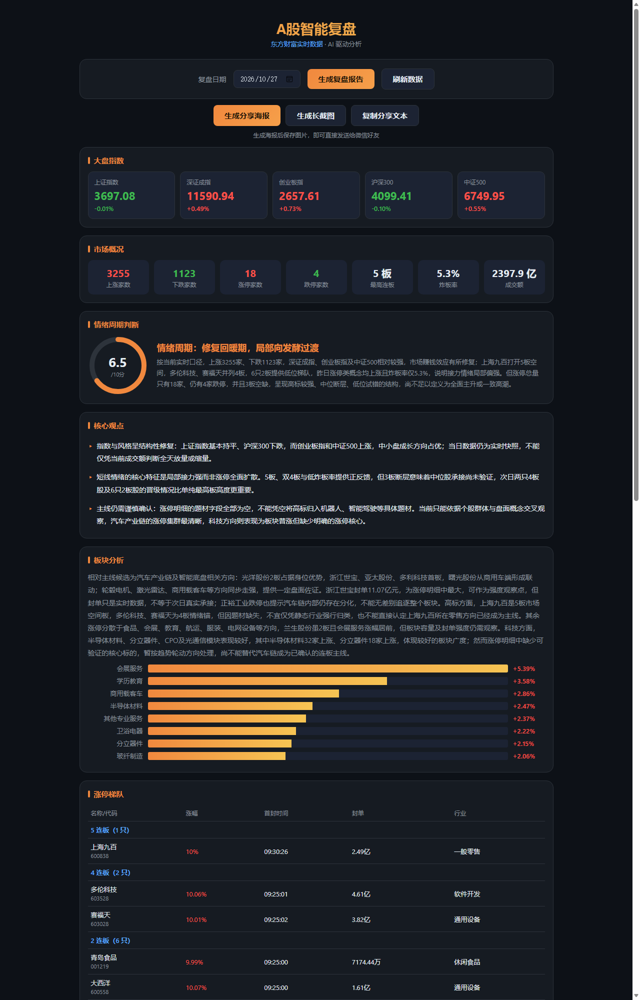

# A股智能复盘系统

基于 Flask + gunicorn + Docker 的 A 股每日复盘 Web 应用。
数据来自东方财富（push2/push2ex/push2his）与腾讯财经免费 API，AI 分析接入火山方舟（豆包）大模型。

## 功能

- **大盘指数**：上证、深成、创业板、沪深300、中证500 五大指数实时行情与成交额
- **涨停/跌停池**：连板梯队、首封时间、封单金额、炸板次数、所属行业
- **AI 情绪周期判断**：基于涨跌家数、涨停跌停数量、连板高度、炸板率等，由大模型输出 1-10 分情绪评分与阶段判断（新周期/活跃/混沌/冰点等）
- **板块热度排行**：行业板块 + 概念板块涨幅榜（含领涨股）
- **明日策略**：机会方向、风险警示、核心建议
- **选股策略**：当日最强主线 × 1/2 连板，按评分排序（主线热度+连板+封单+首封+换手）
- **每日荐股（一进二打板战法）**：首板 4 步筛选（封板质量/题材强度/股价位置/市值流动性）打分，输出精选候选与关注池
- **次日竞价提示**：竞价时段自动判定高开幅度/竞价量能，提示可入手/观察/放弃
- **报告快照页**：每日报告渲染为单文件静态 HTML（数据内嵌），可分享到 QQ/微信直接打开，支持下载存档
- **一键分享**：生成分享海报 / 完整报告长截图 / 复制分享文本
- **指定历史日期复盘**：支持生成任意交易日的复盘报告并沉淀存档
- **SSE 进度推送**：报告生成过程实时展示

## 效果图





## 交流

感兴趣的朋友欢迎加入 QQ 交流群：**1129775387**（每日复盘、选股策略、一进二打板战法讨论）

## 访问

- 服务器: 部署后访问 `http://<服务器IP>:5000`（内网部署示例）
- 手机端 / 桌面端自适应

## 技术架构

```
浏览器(HTML/JS)
   │ SSE 进度
   ▼
Flask (app.py) ──┬── 数据获取模块 data_fetcher.py
   │             │     ├── 东财 push2ex 涨停/跌停/炸板池
   │             │     ├── 腾讯财经 指数实时 / 涨跌家数 / 板块
   │             │     └── 东财 push2his 历史K线
   │             └── AI 分析模块 ai_analyzer.py
   │                   └── 火山方舟 OpenAI 兼容接口 (doubao-seed-2-1-pro)
   ▼
gunicorn (单worker多线程, 适配SSE) + Docker
```

## 部署

```bash
# 服务器上
cd /home/<用户名>/a-stock-review
sudo docker build -t a-stock-review .
sudo docker run -d --name a-stock-review --restart always \
  -p 5000:5000 --env-file .env -e TZ=Asia/Shanghai \
  -v $(pwd)/reports:/app/reports a-stock-review
sudo ufw allow 5000/tcp
```

## 配置 (.env)

```ini
AI_BASE_URL=https://ark.cn-beijing.volces.com/api/v3
AI_API_KEY=你的火山方舟API Key
AI_MODEL=doubao-seed-2-1-pro-260915
PORT=5000
```

- 未配置/未开通模型时，AI 分析自动降级为规则引擎评分，系统始终可用
- 切换 DeepSeek：`AI_BASE_URL=https://api.deepseek.com` + `AI_MODEL=deepseek-chat`

## AI 模型开通指引（重要）

当前 API Key 已配置，但火山引擎账号需先开通模型服务才能调用大模型：

1. 打开火山引擎方舟控制台：https://console.volcengine.com/ark
2. 登录你的火山引擎账号
3. 左侧「开通管理」→ 找到 `doubao-seed-2-1-pro` 或其他豆包模型 → 点击开通
4. 开通后无需修改任何代码/配置，重启容器即可生效：

```bash
sudo docker restart a-stock-review
```

## 数据准确性说明

- 涨停池价格单位为"毫"，已做自动换算（>1000 除以 1000）
- 跌停池使用 `sort=zdp:asc`（`fbt:asc` 会返回空）
- 涨跌家数为腾讯全市场逐只统计（缓存 3 分钟）
- 历史日期无全市场涨跌家数实时口径，报告中会注明
- 东财接口限流：内置 3 次重试 + 随机延迟(3-6s) + UA 轮换

## 报告存储

生成报告保存于 `reports/YYYYMMDD.json`，可在页面「最新报告」中随时回看。

## API

| 接口 | 说明 |
|------|------|
| `GET /` | 前端页面 |
| `GET /api/market?date=YYYY-MM-DD` | 市场数据（不生成报告） |
| `POST /api/report` `{"date":"YYYY-MM-DD"}` | 生成报告（SSE 流） |
| `GET /api/report?date=YYYY-MM-DD` | 读取已生成报告 |
| `GET /api/reports` | 报告列表 |
| `GET /api/status` | 系统状态 |

## 免责声明

本系统数据来自公开免费接口，AI 内容由大模型生成，仅供参考，不构成投资建议。股市有风险，入市需谨慎。
